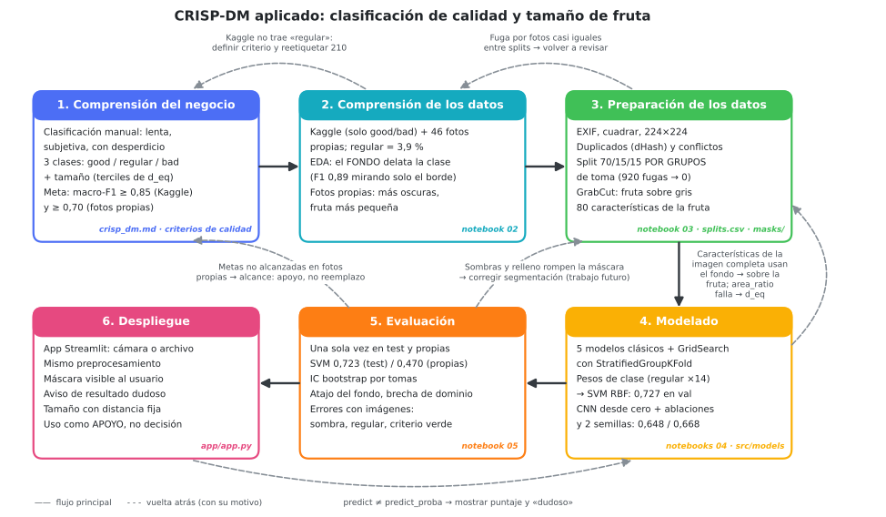

# Metodología CRISP-DM aplicada al proyecto

*Así recorrimos CRISP-DM en este proyecto. Cada caja cuenta lo que hicimos en esa fase y dónde quedó
documentado. Las flechas punteadas son las veces que **tuvimos que devolvernos** a una fase anterior porque
descubrimos algo; el motivo está escrito junto a cada flecha y explicado en la sección 7. (El diagrama se
genera con `python -m src.utils.diagrama_crisp_dm`.)*

## 1. Comprensión del negocio
- ¿Por qué es importante clasificar la calidad? Impacto económico y social.

Es importante clasificar la calidad porque la clasificación manual de frutas y verduras depende del error y ritmo humano. Además, este sector requiere recortar costos y tiempo de producción, pues es un sector vital para la economia y el dia a dia y bolsillo de los colombianos.

- Definición de clases de calidad y criterios de tamaño.

Decidimos usar 3 clases de calidad: Buena, regular, mala. 

Cada una basada en el aspecto de la fruta, su madurez, manchas y golpes. 

- Métricas de éxito (p. ej. F1-macro, accuracy, matriz de confusión).

Usaremos F1 macro, accuracy, precision y recall de la clase "mala" y kappa.

F1 macro ≥ 0,85 en Kaggle y ≥ 0,70 en fotos propias.

Especificamente, para la parte de la calidad de los datos se usará Kappa de Cohen, cobertura e índice de desbalance.

En el despliegue usaremos latencia por imagen, tamaño del modelo y calibración de la confianza.

**Cómo decidimos cada clase** (más detalle en `data/README.md`):
- **Buena:** casi sin defectos, menos del 5 % de la piel afectada.
- **Regular:** manchas, golpes leves o color raro (muy verde o muy madura) en un 5 a 25 % de la piel. Todavía
  se puede vender, con descuento.
- **Mala:** más del 25 % dañado, podrida, con moho o con la piel rota.

Si una fruta queda entre dos clases, le ponemos la peor.

**Tamaño:** pequeño, mediano o grande, comparando la fruta con las demás de su mismo tipo.

El análisis ético y el análisis inicial de impactos de esta fase están en `docs/etica.md` y
`docs/impactos.md`.

## 2. Comprensión de los datos
- Distribución de clases, desbalanceo, calidad y variabilidad de imágenes.

Usamos tres frutas: manzana (`apple`), banano (`banana`) y naranja (`orange`). Escogimos frutas comunes en Colombia que también están en Kaggle.

Datos: 5.659 imágenes de Kaggle (tras limpieza) + 46 fotos propias (~5 por fruta y calidad). Kaggle solo trae good/bad; la clase `regular` se construyó reetiquetando a mano 210 imágenes candidatas, más las fotos propias. Total 5.705 imágenes; `regular` es ~3,9 % (desbalance fuerte).

Lo más importante que encontramos al explorar los datos (`notebooks/02_data_understanding_eda.ipynb`):
- **En Kaggle, el fondo delata la calidad.** Un modelo que solo mira los bordes de la foto, sin ver la fruta,
  acierta casi el 90 %. Si no hacíamos algo, nuestros modelos podían aprender a mirar el fondo.
- **Hay muchas fotos casi repetidas,** tomadas con segundos de diferencia. Si se reparten al azar, la misma
  foto puede quedar para entrenar y para probar.
- **Nuestras fotos son distintas a las de Kaggle:** más oscuras y con la fruta más pequeña dentro de la foto.
  Desde aquí sospechamos que el modelo iba a funcionar peor con ellas.

## 3. Preparación de los datos
- Segmentación de `mixed_quality`, redimensionado, normalización, aumento de datos, manejo de desbalanceo.

Pipeline (scripts en `data/`, detalle en `data/README.md` y `docs/GUIA_SIGUIENTE_ETAPA.md`):
1. `prepare_dataset.py`: corrección EXIF, cuadrado con relleno del color de fondo, 224×224, estimación de `area_ratio`.
2. `select_regular_candidates.py`: candidatas a `regular` + revisión manual.
3. `find_duplicates.py`: elimina ~20 % de duplicados (dHash ≤ 10, con espejo).
4. `resolve_label_conflicts.py`: elimina 31 gemelas con etiqueta contradictoria.
5. `make_splits.py`: split 70/15/15 estratificado **por grupos de la misma toma** (dHash + ráfagas por hora de captura) para evitar fuga; fotos propias como `test_propias`.

Además (`notebooks/03_data_preparation.ipynb`):

6. **Recortar la fruta del fondo** con GrabCut (`src/data/segmentacion.py`). Después de recortarla, el
   modelo que miraba los bordes ya no acierta: **la trampa del fondo desaparece**.
7. **Medir el tamaño** con el área de la fruta recortada, `d_eq = 2·√(área/π)`. Antes lo intentamos contando
   los píxeles distintos al fondo, pero fallaba con fondos con textura.
8. **Describir cada fruta con 80 números** (color, manchas, textura, bordes y forma), usando solo los
   píxeles de la fruta (`src/features/`).
9. **Compensar que haya tan poca fruta *regular*:** al entrenar, equivocarse con una *regular* cuenta unas
   14 veces más que con una buena.

## 4. Modelado

**Modelos clásicos** (`notebooks/04_modeling_ml_clasico.ipynb`).
- Probamos cinco: regresión logística, KNN, SVM, Random Forest y XGBoost.
- A cada uno le buscamos la mejor configuración probando varias combinaciones, con validación cruzada en 5
  partes. Las fotos de una misma toma siempre quedaron juntas.
- **Ganó el SVM**, con macro-F1 0,72 en validación cruzada y 0,73 en validación.
- Random Forest y XGBoost se aprendieron los datos de memoria: casi perfectos al entrenar, pero peores con
  datos nuevos.
- Sin el peso extra para *regular*, el SVM nunca la predecía.

**Red neuronal desde cero** (`notebooks/04_modeling_cnn.ipynb`).
- Es una red pequeña de tres bloques, con unos 102.000 parámetros.
- Probamos variantes cambiando una sola cosa a la vez: velocidad de aprendizaje, peso de las clases,
  aumento de datos y número de filtros.
- La entrenamos dos veces con distinta semilla, y una vez más con la foto completa para el experimento del
  fondo.
- La mejor logró 0,65 y 0,67 en validación (según la semilla).

**Cómo elegimos.** Solo con los datos de validación. El SVM quedó como modelo principal y la red neuronal
como el modelo de deep learning.

Las matemáticas de cada modelo están en `docs/formulacion_matematica.md` y su estructura en
`docs/arquitectura.md`.

## 5. Evaluación

`notebooks/05_evaluation.ipynb`. Probamos los modelos elegidos **una sola vez** con los datos de prueba
de Kaggle y con nuestras 46 fotos, sin volver a entrenar ni cambiar de modelo después de ver los resultados.

| Modelo | val | test | test_propias [IC 95 %] |
|---|---|---|---|
| Línea base (aleatorio estratificado) | 0,311 | 0,332 | 0,352 |
| **SVM** | 0,727 | **0,723** | **0,470** [0,34; 0,58] |
| CNN | 0,648 | 0,647 | 0,382 [0,29; 0,47] |

- **Con fotos de Kaggle, el SVM funciona igual de bien en prueba que en validación.** Con nuestras fotos
  cae mucho, y esa caída es más grande que la diferencia entre modelos.
- **Por qué cae con nuestras fotos:**
  - en 39 de 46 fotos el recorte de la fruta incluyó una sombra o un pedazo de pared;
  - la fruta se ve más pequeña;
  - tenemos otra idea de *regular*, por ejemplo con las naranjas verdes.
- **El fondo influía algo en la red neuronal, pero no en el SVM.** No es la razón principal de la caída.
- **No alcanzamos las metas** (0,85 y 0,70). Respuesta a la pregunta del negocio: *sí sirve como ayuda* con
  fotos parecidas a las de Kaggle; *todavía no* con nuestras fotos.

## 6. Despliegue

Hicimos una app web con Streamlit (`app/app.py`; cómo abrirla está en `docs/instalacion.md`, sección 4):
- Se puede tomar la foto con la cámara o subir una imagen. La foto se prepara **igual que en el
  entrenamiento**.
- Muestra qué parte de la foto tomó como fruta, para que el usuario vea qué analizó el modelo.
- Dice la calidad, qué tan inclinado está el modelo hacia cada clase y el tamaño.
- Avisa **"Resultado dudoso"** cuando el modelo no está seguro, y también si el recorte de la fruta parece
  mal hecho.
- Da instrucciones para tomar la foto: una fruta, fondo liso, buena luz y **siempre a la misma distancia**.
- Tarda unos 0,15 segundos por foto en un portátil normal.

## 7. Iteraciones: vueltas atrás en el ciclo

No recorrimos CRISP-DM en línea recta. Varias veces descubrimos algo que nos obligó a devolvernos:

| Nos devolvimos de… a… | Qué descubrimos | Qué cambiamos |
|---|---|---|
| Datos → Negocio | Kaggle solo trae frutas buenas y malas | Definimos qué es *regular* y clasificamos 210 fotos a mano |
| Preparación → Datos | Al repartir las fotos, 920 parejas casi iguales quedaban entre entrenamiento y prueba | Revisamos de nuevo los datos para encontrar fotos repetidas y agrupar las de una misma toma |
| Modelado → Preparación | Con la foto completa, los modelos usaban el fondo; la forma de medir el tamaño fallaba con fondos con textura | Describimos solo la fruta recortada y medimos el tamaño con su área |
| Evaluación → Negocio | No alcanzamos las metas con nuestras fotos | Cambiamos el objetivo: el sistema es una **ayuda**, no un reemplazo |
| Evaluación → Preparación | Las sombras y los bordes de relleno arruinan el recorte de la fruta en nuestras fotos | Queda como trabajo futuro: mejorar el recorte y tomar más fotos |
| Despliegue → Modelado | En la app, la clase elegida y la barra más alta a veces no coincidían | La app muestra la medida con la que el SVM decide y avisa cuando el resultado es dudoso |
